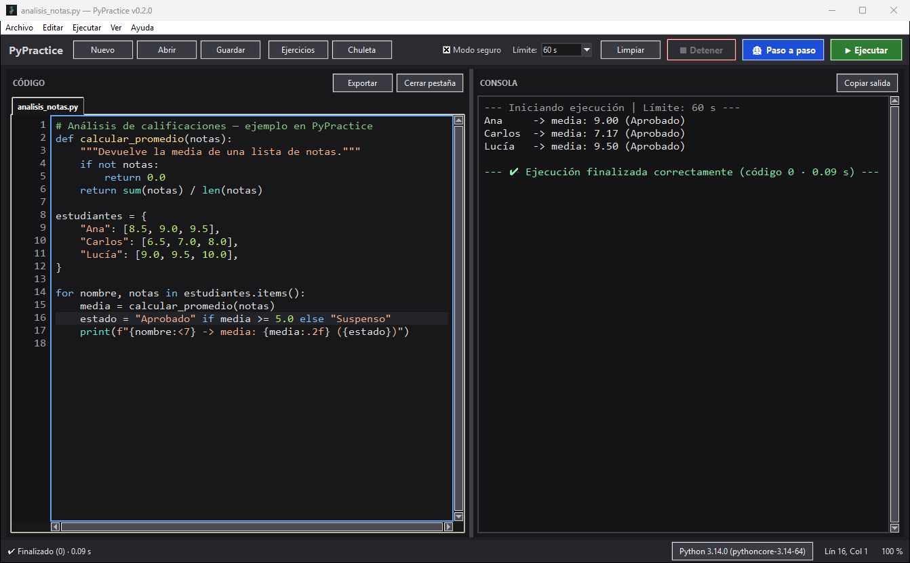
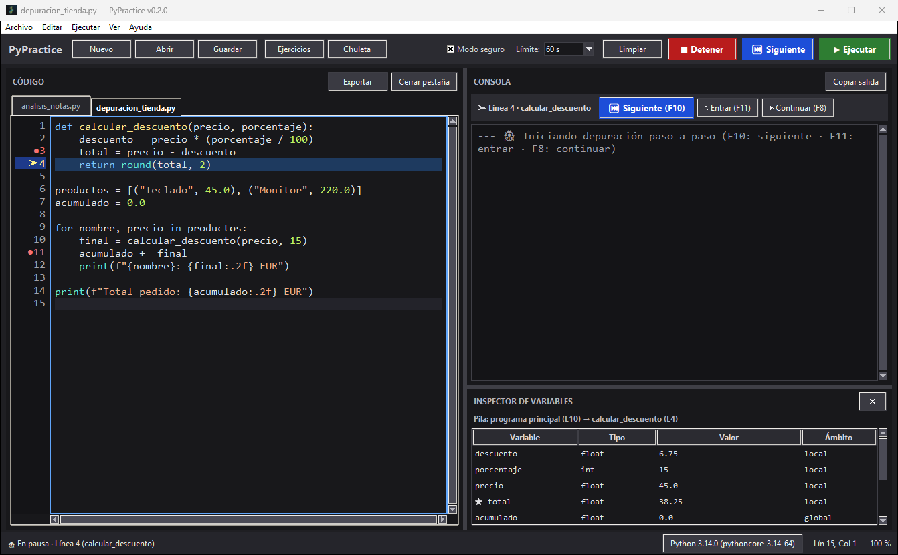
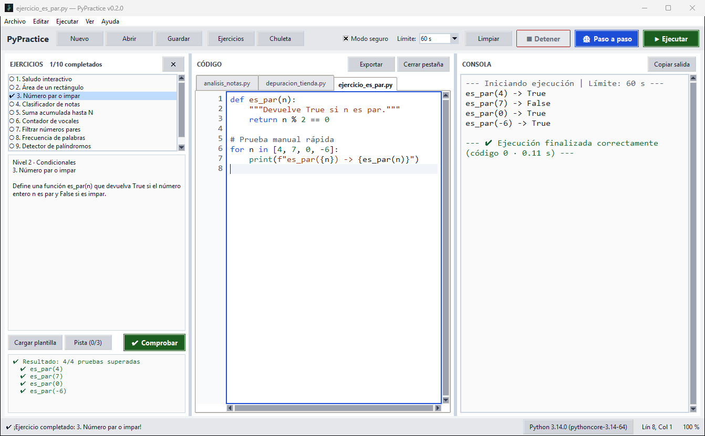

<div align="center">

# PyPractice

**Educational, accessible, zero-dependency Python desktop IDE — built with defensive engineering from day one.**

[](https://www.python.org/)
[](https://docs.python.org/3/library/)
[](#accessibility)
[](LICENSE)
[](https://indomitusone.com/)

</div>

---

## Overview

**PyPractice** is a lightweight desktop workbench designed for learning and practicing Python safely without heavy toolchains or third-party runtime dependencies. Built 100% on the **Python Standard Library and Tkinter**, it combines a syntax-aware multi-tab editor, an isolated subprocess runner, a visual step-by-step debugger, progressive exercises with automated grading, and WCAG AA/AAA accessibility.

> **Language note:** The application UI, educational diagnostics, exercises, and built-in cheatsheet are currently authored in **Spanish (`es`)**, while the architecture, security policy, and repository documentation follow English engineering standards.

---

## Screenshots

### Editor & Isolated Console (Dark Theme — WCAG AA)



### Visual Step-by-Step Debugger & Variable Inspector



### Guided Exercise Library & Automated Grading (Light Theme — WCAG AA)



---

## Key Features

### Defensive Execution & Guardrails
- **Sanitized Subprocess Environment:** Child scripts receive a minimal allowlisted environment—never inheriting host API keys, tokens, or private environment variables.
- **Session Isolation (`-I`, `-X utf8` & Private Temp CWD):** Each run executes inside a dedicated `tempfile.TemporaryDirectory()` using Python's isolated mode (`-I`), explicit UTF-8 mode (`-X utf8`), and validated absolute interpreter paths (excluding relative/CWD entries from `PATH`).
- **DoS & Orphan-Process Containment:** Non-blocking stream readers with bounded queues, configurable timeouts, output-flood circuit breakers, and full process-tree teardown via **Windows Job Objects** (`JOB_OBJECT_LIMIT_KILL_ON_JOB_CLOSE`) and **POSIX process groups** across the runner, debugger, and exercise evaluator.
- **Preventive Safe Mode (AST Analysis):** Inspects the AST before execution, debugging, or grading to warn about sensitive operations (`subprocess`, `os`, `ctypes`, `winreg`, `shutil`, `socket`, `pickle`, `runpy`, `eval`, `exec`, dynamic reflection/dunders, write-mode or external-path `open()`).
- **Tamper-Resistant Debugger Channel:** Uses a per-session randomized protocol prefix (`secrets.token_hex`) so user `stdout` cannot spoof debugger UI events.

> For exact trust boundaries and limitations, read **[SECURITY.md](SECURITY.md)**.

### Smart Editor & Interactive Console
- **Multi-Tab Workspace:** Open, Save, Save As, recent files, unsaved-change indicators (`●`), and automatic crash recovery snapshots.
- **Exact Lexical Highlighting (`tokenize`):** Accurately highlights multiline strings, f-strings, comments, decorators, keywords, and built-ins with non-blocking debounce.
- **Python Editing Ergonomics:** 4-space `Tab` / `Shift+Tab`, auto-indent after `:`, auto-closing quotes/brackets, comment toggling (`Ctrl+/`), bracket matching, active-line highlight, and **Find / Replace** (`Ctrl+F` / `Ctrl+H`).
- **Protected Interactive Console:** Live `input()` support with distinct `stdin` styling, read-only history protection, execution status, exit code, and elapsed time.

### Visual Debugger, Exercises & Learning Tools
- **Step-by-Step Visual Debugger (`bdb`):** Runs in an isolated subprocess with clickable gutter breakpoints (`F9`), active-line tracking (`➤`), live call stack, `input()` support, and a live local/global variable inspector (changed values marked with `★`).
- **Educational Diagnostics (ES):** Translates syntax errors and runtime tracebacks (`NameError`, `TypeError`, `IndexError`, `ZeroDivisionError`, etc.) into clear explanations, hides internal temp paths (`"Tu código"`), and offers one-click jump-to-line.
- **Progressive Exercise Library:** 10 structured challenges across 5 difficulty levels with step-by-step hints, isolated automated test grading (`function` and `stdio` modes), and persistent progress tracking.
- **Templates, Cheatsheet & Export:** 8 starter templates (including Tkinter GUI), searchable Python cheatsheet with one-click insert (`F2`), and practice report export (code + console output + test results) to `.md` or `.txt` (`Ctrl+E`).
- **Interpreter / `venv` & `sys.argv` Selector:** Auto-detects trusted local Python installations and lets you configure virtual environments and command-line arguments.

### Accessibility
- **4 High-Readability Themes:** *Dark (WCAG AA)*, *Light (WCAG AA)*, *High Contrast (WCAG AAA)*, and *Color-Blind Safe (Okabe-Ito)*—all contrast-verified in the automated test suite.
- **Non-Color Status Cues:** Distinct symbols (`✔`, `✖`, `⚠`, `➤`, `●`) alongside color coding.
- **Full Keyboard Navigation & High-DPI:** Global shortcuts, visible focus rings on `ttk` controls, native Windows High-DPI awareness, dynamic zoom (`Ctrl++`/`-`/`0`), font selector (including *Atkinson Hyperlegible* and *OpenDyslexic* when installed), and optional audio feedback.

---

## Architecture

| Module | Responsibility |
| :--- | :--- |
| [`main.py`](main.py) | Application entry point, tabbed UI, protected console, panels, accessibility, and dialogs |
| [`editor.py`](editor.py) | `tokenize`-based Python editor, synchronized line gutter, breakpoints, editing assistance, find/replace |
| [`runner.py`](runner.py) | Isolated subprocess execution, Windows Job Objects / POSIX process groups, sanitized env, timeouts, output circuit breaker |
| [`debugger.py`](debugger.py) | Isolated `bdb` step-by-step debugger with randomized session framing, `input()` bridge, and output cap |
| [`safety.py`](safety.py) | Static AST inspector for preventive Safe Mode warnings |
| [`exercises.py`](exercises.py) | 10 progressive challenges and isolated process-tree-managed automated evaluator |
| [`diagnostics.py`](diagnostics.py) | Syntax and runtime traceback translator with path sanitization |
| [`templates.py`](templates.py) | Starter templates, searchable Python cheatsheet, and `.md`/`.txt` practice exporter |
| [`themes.py`](themes.py) | WCAG AA/AAA & Okabe-Ito color palettes and `ttk` styles |
| [`settings.py`](settings.py) | Persistent preferences, exercise progress, and crash-recovery snapshots |

---

## Requirements & Installation

### Requirements
- **Python 3.10 or higher** with `tkinter` (included by default in official Windows/macOS installers; on Debian/Ubuntu install `python3-tk`).
- **Zero external `pip` packages** required to run or test.

### Run from Source
```bash
git clone https://github.com/indomitusone/pypractice.git
cd pypractice
python main.py
```

---

## Configuration

User preferences, exercise completion progress, and crash-recovery drafts are stored locally as plain JSON files without external services:

- **Windows:** `%APPDATA%\PyPractice\` (`config.json`, `recovery_session.json`)
- **Linux / macOS:** `${XDG_CONFIG_HOME:-~/.config}/pypractice/` (`config.json`, `recovery_session.json`)

Key configurable options (available from the UI menus and toolbar):
- **Safe Mode (AST analysis):** Enabled by default (`Ejecutar > Modo seguro`).
- **Isolated Python Mode (`-I`):** Enabled by default (`Ejecutar > Modo aislado de Python (-I)`).
- **Execution Timeout:** `10 s`, `30 s`, `60 s` (default), `120 s`, or `Sin límite` (recommended for Tkinter GUI scripts).
- **Interpreter & `sys.argv`:** Select any validated system Python or virtual environment (`Ejecutar > Configurar intérprete / argumentos...`).

---

## Keyboard Shortcuts

| Shortcut | Action |
| :--- | :--- |
| `F5` / `Ctrl+Enter` | Run current script |
| `Shift+F5` | Stop execution or debugging |
| `F10` / `F11` / `F8` | Debug: Step Over / Step Into / Continue |
| `F9` | Toggle breakpoint on current line |
| `F6` | Toggle focus between Editor and Console |
| `Ctrl+L` | Clear console |
| `Ctrl+N` / `Ctrl+O` / `Ctrl+S` | New / Open / Save file |
| `Ctrl+E` | Export practice report (`.md` / `.txt`) |
| `Ctrl+F` / `Ctrl+H` / `Ctrl+/` | Find / Replace / Toggle comment |
| `Ctrl+Shift+E` / `Ctrl+Shift+V` | Toggle Exercises / Variable Inspector panel |
| `Ctrl++` / `Ctrl+-` / `Ctrl+0` | Zoom in / out / reset |
| `F1` / `F2` | Keyboard shortcuts / Python cheatsheet |

---

## Security Considerations

PyPractice applies **defense-in-depth engineering** to prevent accidental damage, host environment secret leakage, runaway loops, and orphan processes. However, **it is not an OS-level malware sandbox**: executed code runs with your local OS user permissions, and AST Safe Mode is an advisory educational guardrail rather than a hard containment boundary. Only run code you wrote or trust.

Read the full threat model and responsible disclosure policy in **[SECURITY.md](SECURITY.md)**.

---

## Testing

Run the complete automated test suite (WCAG contrast ratios, AST Safe Mode, diagnostics, sanitized runner, timeouts, output circuit breakers, debugger anti-spoofing, exercise evaluator, and UI smoke tests):

```bash
python -m unittest discover -s tests -v
```

On headless Linux environments, run under `xvfb-run`:

```bash
xvfb-run -a python -m unittest discover -s tests -v
```

---

## Packaging for Windows

To build a standalone Windows bundle (`dist/PyPractice/PyPractice.exe`) using the pinned PyInstaller configuration (`upx=False` to minimize antivirus false positives):

```bat
build_windows.bat
```

Optionally set `PYPRACTICE_CODESIGN_IDENTITY` before building to code-sign the generated executable via [`PyPractice.spec`](PyPractice.spec).

---

## Roadmap

- [ ] Internationalization (`es` / `en` UI toggle).
- [ ] Expanded exercise library (file handling, OOP, and defensive input validation exercises).
- [ ] Optional `pyproject.toml` packaging and Ruff linting integration in CI.

See **[CHANGELOG.md](CHANGELOG.md)** for release history.

---

## Contributing

Bug reports, accessibility feedback, and pull requests are welcome via GitHub Issues and Pull Requests. Please verify changes with `python -m unittest discover -s tests -v` before opening a PR. For security-sensitive reports, follow **[SECURITY.md](SECURITY.md)**.

---

## License & Author

Released under the **[MIT License](LICENSE)**.

Built by **Jose Alonso** · **[Indomitus One](https://indomitusone.com/)** ([github.com/indomitusone](https://github.com/indomitusone)) — *Security with engineering rigor.*
